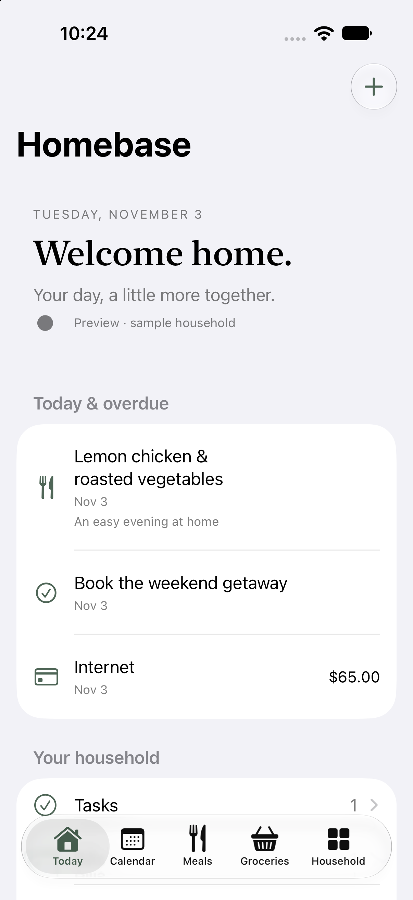

# Homebase

A shared home for plans, meals, bills, tasks, and groceries. Native SwiftUI for iPhone and iPad, backed by a Dockerized API on your own server.

## What’s included

- **Today:** upcoming and overdue household items, quick add, sync status.
- **Calendar:** shared events and an opt-in two-way bridge to one shared iCloud calendar.
- **Dinners:** seven-day planner, saved meals, ingredients to groceries.
- **Bills:** amounts, currencies, weekly/monthly/yearly recurrence, reminders, payment dates.
- **Tasks:** dates, reminders, completion, recurrence.
- **Groceries:** General first, then stores alphabetically; items alphabetically within each store.
- **Sync:** durable offline edit queue, live foreground WebSocket invalidation, incremental pulls, idempotent writes, explicit conflict resolution.
- **Notifications:** APNs shared-change alerts and server-driven due reminders. Setup required.
- **Operations:** persistent SQLite/WAL volume, daily backups, CI-gated automatic deployment.

The app uses warm sage accents, native typography, familiar iOS controls, and system light/dark appearance. There are no household user accounts. Pair each phone once with a short-lived code; its credential stays in Keychain.



## Repository layout

- `ios/Homebase.xcodeproj` — native iOS app, iOS 17+
- `server/` — FastAPI, SQLite, APNs worker, local administration CLI
- `compose.yaml` — API and optional Cloudflare Tunnel
- `deploy/` — systemd user timers and deployment/backup scripts
- [Setup guide](docs/SETUP.md) — Cloudflare, Apple signing, push, pairing, recovery
- [Architecture and boundaries](docs/ARCHITECTURE.md)

## Local verification

```sh
python3 -m venv .venv
. .venv/bin/activate
pip install -r server/requirements.txt
python -m unittest discover -s server/tests -v
xcodebuild -project ios/Homebase.xcodeproj -scheme Homebase \
  -sdk iphonesimulator -configuration Debug CODE_SIGNING_ALLOWED=NO build
mkdir -p secrets
chmod 700 secrets
touch secrets/apns.p8
chmod 644 secrets/apns.p8
docker compose up -d --build api
```

The API binds to host loopback port 8092. Public access requires the optional tunnel; the iOS app requires HTTPS. All household routes require a device credential. `/health` returns only health, and `/v1/pair` accepts only a single-use server-generated invite.

## Status and limits

This is an initial implementation, not an App Store release. Build and server tests do not validate real APNs delivery, iCloud behavior, or installation on your phones. Complete the setup guide and its two-device acceptance checks before relying on Homebase for time-critical reminders.

The calendar bridge runs on one designated phone and covers the previous 30 days and next year. It mirrors event title, dates, all-day status, and notes. It edits recurring events as individual occurrences; create or modify series, attendees, alarms, and locations in Apple Calendar. Conflicting edits and missing iCloud events require review in Settings. iOS controls background execution; fixed polling while closed or force-quit cannot be guaranteed.

Bills track payment dates, not bank transactions or historical amount changes. Monthly recurrence clamps to valid dates (January 31 → February 28 → March 28). Offline reminders depend on the server having received the edit and the phone being reachable by APNs. No in-app login is required, so anyone who can unlock the phone can open its cached household data.

## Security reporting

Do not post secrets or household data in public issues. Report security concerns privately through the repository owner's GitHub contact channels. Never commit `.env`, pairing codes, APNs keys, tunnel credentials, databases, backups, or device caches.
