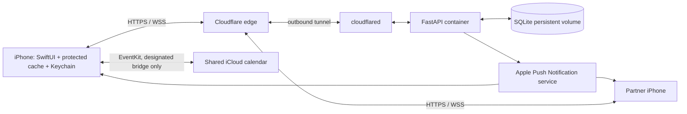

# Architecture

## Sync correctness

All writes use a UUID mutation ID plus expected item revision. SQLite serializes transactions. A retry returns its original result; conflicting revisions return HTTP 409 and the current item. The phone retains its local version and presents a choice rather than silently applying last-writer-wins. Subsequent queued edits to the same item wait for conflict resolution. Deletes are tombstones in the change feed. The cursor and queue persist together in an atomically replaced, iOS-protected file.

WebSockets carry only revision notifications and authenticate through their first message, never URL parameters. The client then fetches authenticated changes in bounded pages. It retries with a 15-second delay if the live connection fails. Background refresh and push handling use the same sync path. Single-process Uvicorn is intentional for this small household deployment; SQLite and notification processing are not configured for horizontal scaling.

## Device security

Invites contain 192 random bits, expire after ten minutes, and can be consumed once. Device tokens contain 384 random bits, are stored hashed in the server database, and use device-only Keychain storage on iOS. The server administrator lists and revokes devices over SSH. Revocation is checked on each HTTP call and while WebSockets remain open. The API has request size limits, pairing/device rate limits, schema validation, no public administration endpoints, and no unauthenticated data endpoints. Containers drop capabilities, use a read-only root filesystem, and the API runs as an unprivileged user.

Cloudflare terminates public TLS and can see HTTP content; this is not end-to-end encryption through Cloudflare. A tunnel prevents direct inbound access to the server but does not itself authenticate phones. Device tokens enforce household access. mTLS is not implemented in this initial version. It can be added at the Cloudflare edge after checking plan support and designing certificate enrollment/rotation; do not enable an mTLS rule before the client supports certificates.

Notifications use generic text. APNs keys and Cloudflare credentials are local mounted secrets. SQLite volumes are not encrypted by this application; use host disk encryption and encrypted off-host backups. Local backups survive container replacement but do not survive loss of the server's disk. Revoking a phone stops future access; it cannot remotely erase an offline cache.

## Calendar

The server grants a single device ownership of the bridge. The phone explicitly requests EventKit access and selects one writable iCloud/CalDAV calendar. Other calendars are never uploaded. The user should select an already shared iCloud calendar, not another provider's calendar. EventKit's writable CalDAV list is broader than iCloud, so provider/source names are displayed.

The bridge uses stable external event keys, persistent fingerprints, and a Homebase URL marker on exported events. External changes update Homebase; Homebase changes update Apple Calendar. Concurrent changes become review issues. Missing events require confirmation to avoid deleting household plans during temporary iCloud gaps. Switching bridge phones requires disconnecting the old bridge or revoking that device. Calendar sync needs real-device testing, including recurrence, remote changes, deletions, and switching bridge ownership.

## Deployment

GitHub Actions runs API tests, a Docker build, and an unsigned iOS build. The server timer polls `main` every two minutes and requires a successful Verify workflow for that exact commit. The script locks concurrent deploys, builds before replacing the app, takes a pre-deploy SQLite backup, and records the deployed SHA only after health checks pass. Failed builds preserve the running service. Failed startup retries on the next timer tick; automatic rollback of schema changes is not implemented. The current schema uses additive creation, not a general migration framework.

Daily backups retain the newest 30 daily files. Pre-deployment backups are retained separately and need periodic disk-space review. Follow SETUP.md to copy backups off-host and restore. The public repository contains source and setup documentation only.
